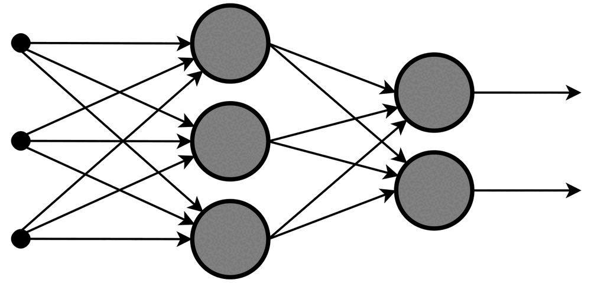
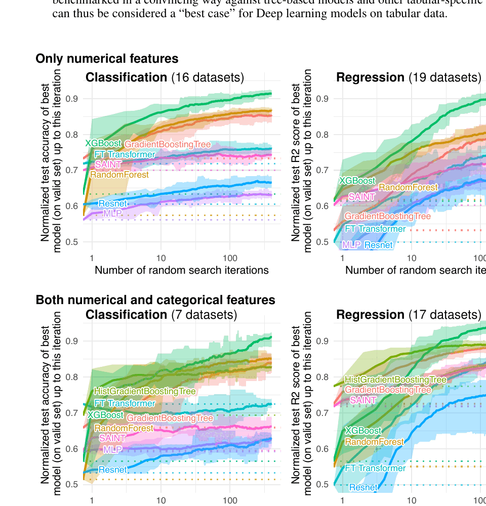

# When Neural Networks Help

“Traditional ML” is a convenient course label, not one algorithm. It may refer
to a linear model, nearest neighbours, a decision tree, a random forest, or a
gradient-boosted ensemble. A useful comparison names the actual candidates and
their assumptions rather than treating every non-neural model as one baseline.

## What a Feed-Forward Network Adds

*Feed-forward neural-network diagram by Glosser.ca, licensed under
[CC BY-SA 3.0](https://creativecommons.org/licenses/by-sa/3.0/). Source:
[Wikimedia Commons](https://commons.wikimedia.org/wiki/File:Multi-Layer_Neural_Network-Vector-Blank.svg).*

A dense neural network repeatedly applies learned weighted transformations and
non-linear activation functions. Hidden layers can learn useful intermediate
representations instead of relying entirely on manually designed features. This
flexibility also creates more choices: architecture, optimizer, learning rate,
batch size, regularisation, stopping rule, and random initialization.

More flexibility is not free. It can increase variance between runs, tuning
effort, training cost, and the difficulty of explaining failures.

## Data Modality Changes the Starting Point

Neural networks have a strong advantage when the model must learn
representations from high-dimensional, unstructured inputs such as images,
audio, text, or sequences. Pretrained networks may make this advantage available
even when the project dataset is modest.

For medium-sized tabular data, strong tree ensembles remain essential
challengers. A NeurIPS benchmark found that tree-based models often outperformed
the evaluated deep-learning models on representative medium-sized tabular
datasets. That result is evidence about a benchmark, not a universal law.

*Figure 1 from Grinsztajn, Oyallon, and Varoquaux, “Why do tree-based models
still outperform deep learning on typical tabular data?” Source:
[NeurIPS 2022](https://papers.nips.cc/paper_files/paper/2022/hash/0378c7692da36807bdec87ab043cdadc-Abstract-Datasets_and_Benchmarks.html).*

The later comparison by
[Gorishniy et al.](https://arxiv.org/abs/2106.11959) similarly concludes that
there is no universally superior solution. Dataset structure, preprocessing,
architecture, tuning budget, and evaluation protocol all matter.

## Replace Rules of Thumb with Testable Questions

Avoid rules such as “use a neural network above a fixed number of rows.” Ask:

- Is the input tabular, spatial, sequential, textual, visual, or multimodal?
- Is useful structure already captured by engineered features?
- Does performance improve as more training data is added?
- Is a pretrained representation relevant to this task?
- How costly are prediction errors, latency, and retraining?
- Must individual predictions be explained or audited?
- Is the expected gain large enough to change a product decision?

A learning curve is often more informative than a dataset-size slogan. If the
neural network is still improving while the baseline has plateaued, more data
may change the decision. If both have plateaued at similar quality, architecture
complexity may not be the limiting factor.

## Keep “No ML” in the Comparison

A rule, lookup table, process redesign, or manual review may satisfy the product
need with less data risk and operating cost. “No ML” is not a failed model. It
is a valid candidate when prediction adds little value or errors are difficult
to control.

## Check Your Understanding

A neural network improves F1 from 0.82 to 0.823 on one test run. Is that enough
to replace the existing model?

Show solution

No. The team still needs to establish whether the difference is stable and
material, compare error costs and operating constraints, and verify that the
test set was not used during tuning. A small metric increase may not justify a
more expensive system.

## Further Reading

- [NeurIPS 2022 tabular-model benchmark](https://papers.nips.cc/paper_files/paper/2022/hash/0378c7692da36807bdec87ab043cdadc-Abstract-Datasets_and_Benchmarks.html)
- [Revisiting Deep Learning Models for Tabular Data](https://arxiv.org/abs/2106.11959)
- [Google Machine Learning Crash Course: Neural networks](https://developers.google.com/machine-learning/crash-course/neural-networks)
