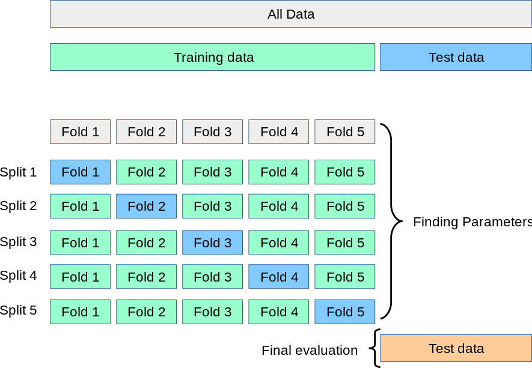

# Design a Fair Comparison

A comparison is fair when the models answer the same product question using the
same held-out observations and decision metric. It does not require identical
preprocessing or hyperparameters. Each model may need an appropriate pipeline,
but no candidate should receive privileged access to the test set or an
unlimited search budget.

## Protect the Final Test Set

*Cross-validation workflow from the
[scikit-learn model-evaluation guide](https://scikit-learn.org/stable/modules/cross_validation.html).
The documentation and illustration are licensed under
[BSD-3-Clause](https://github.com/scikit-learn/scikit-learn/blob/main/COPYING).*

Use training data to fit parameters, validation data or cross-validation to make
model choices, and the untouched test set once for the final comparison. Looking
at test results after every architecture change converts the test set into a
hidden validation set and makes the final estimate optimistic.

The split strategy must respect the project:

- stratify when class balance matters;
- keep observations from the same person, customer, device, or group together;
- preserve time order when predicting the future; and
- fit imputers, scalers, encoders, and feature selection on training data only.

## Freeze the Protocol Before Results

Complete `model-comparison-plan.md` before building the neural network. Record:

- the product decision and cost of important errors;
- the original baseline and a simple no-skill or rule-based baseline;
- immutable train, validation, and test membership;
- primary and secondary metrics;
- an acceptable practical difference, not only “higher is better”;
- model-specific preprocessing;
- the allowed tuning budget for each challenger;
- repeated-run policy and random seeds;
- hardware and timing method; and
- the decision rule the team expects to apply.

If the original baseline cannot be reproduced, do not silently replace its
reported score. Document the gap, restore reproducibility where practical, and
keep the original claim distinct from the reproduced result.

## Compare Effort, Not Just Hyperparameter Counts

One model may expose ten hyperparameters and another three. A fair budget can be
expressed as number of trials, elapsed search time, or compute budget. Record the
choice and explain limitations.

Keep the submitted traditional model as the historical baseline. If it received
almost no tuning, an optional stronger traditional challenger may be added under
the same bounded search budget as the neural network. This prevents the exercise
from comparing a carefully tuned network against an intentionally weak model.

## Treat Neural Training as a Distribution

Weight initialization, minibatch order, and some hardware operations make
neural training stochastic. One run may be unusually favourable. Repeat the
final neural configuration with several declared seeds and report a mean plus
dispersion or range. When resources permit only one run, label that limitation
rather than presenting one value as stable.

The official
[Keras reproducibility recipe](https://keras.io/examples/keras_recipes/reproducibility_recipes/)
shows how to control common randomness sources. Determinism improves debugging,
but it does not replace repeated evaluation of model variability.

## Check Your Understanding

Can the neural network use standardized numeric features while a tree ensemble
uses unscaled features?

Show solution

Yes. Fairness means appropriate pipelines fitted on the same training
observations and evaluated on the same test observations. It does not mean
forcing unsuitable preprocessing on every model. The differences must be
documented and leakage-safe.

## Further Reading

- [scikit-learn: Cross-validation](https://scikit-learn.org/stable/modules/cross_validation.html)
- [scikit-learn: Common pitfalls and recommended practices](https://scikit-learn.org/stable/common_pitfalls.html)
- [Keras: Reproducibility in Keras Models](https://keras.io/examples/keras_recipes/reproducibility_recipes/)
