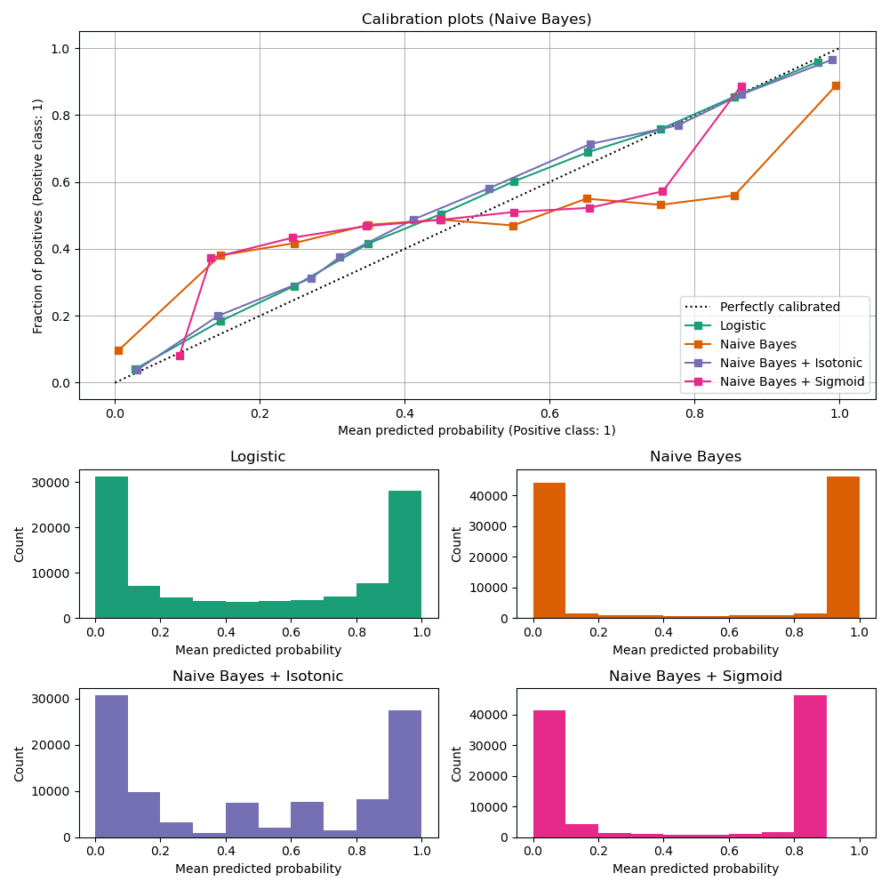

# Evaluate Beyond One Metric

The primary metric should connect to the product decision, but it cannot describe
the whole model. A launch recommendation needs evidence about where predictions
fail, how stable they are, and what the model costs to operate.

## Predictive Evidence

For both candidates, report:

- the same primary metric on the untouched test set;
- secondary metrics that expose important trade-offs;
- a confusion matrix or residual analysis;
- performance for relevant subgroups or operating conditions;
- repeated-run or resampling uncertainty where practical; and
- concrete examples of costly false positives, false negatives, or large errors.

Avoid declaring a winner from rounded values alone. State the absolute and
relative difference, its variability, and whether it crosses the practical
difference defined in the comparison plan.

## Probability Quality and Thresholds

For decisions driven by risk, a predicted probability should mean something. A
model that assigns 0.8 probability to many events should be correct roughly 80%
of the time in that group. Calibration curves compare predicted probabilities
with observed frequencies.

*Calibration curves generated by the scikit-learn project. Source:
[Probability Calibration curves](https://scikit-learn.org/stable/auto_examples/calibration/plot_calibration_curve.html),
licensed under [BSD-3-Clause](https://github.com/scikit-learn/scikit-learn/blob/main/COPYING).*

[Guo et al.](https://proceedings.mlr.press/v70/guo17a.html) showed that modern
neural networks can be poorly calibrated even when their classification
accuracy is strong. Calibration must be checked rather than assumed.

Choose decision thresholds on validation data using product costs. Do not tune a
threshold independently on the final test set for each model and then report the
same test set as unbiased evidence.

## System and Operating Evidence

Measure under the same documented environment:

| Dimension | Evidence to record |
|---|---|
| Training | wall time, hardware, number of trials, repeated runs |
| Inference | batch size, warm-up rule, median and tail latency, throughput |
| Resources | model size, peak memory where available, CPU/GPU requirement |
| Maintenance | preprocessing dependencies, retraining steps, monitoring needs |
| Interpretability | global behaviour, local explanations, known limitations |
| Governance | sensitive groups, auditability, data constraints, human oversight |

Small benchmark scripts can be noisy. Run several measurements, ignore or
separate warm-up, and compare the same workload. Report hardware rather than
claiming a universal latency value.

## Compute Is Part of Model Quality

The [Green AI paper](https://arxiv.org/abs/1907.10597) argues that efficiency
should be reported alongside predictive quality. Exact carbon accounting may be
outside this project, but training time, hardware type, trial count, and model
size are observable proxies. A marginal gain obtained through a much larger
search should not be presented as free.

## Keep the Scorecard Legible

Do not hide every dimension inside one weighted score unless the weights come
from an explicit product decision. A scorecard should reveal trade-offs, not
manufacture a precise winner.

## Check Your Understanding

Model A has slightly higher accuracy; Model B is better calibrated and reduces
the most expensive false negatives. Which model wins?

Show solution

The answer depends on the product decision and error costs defined before
evaluation. Accuracy alone cannot decide. The team should quantify the costly
errors, verify calibration and threshold policy, and explain which evidence
drives the recommendation.

## Further Reading

- [On Calibration of Modern Neural Networks](https://proceedings.mlr.press/v70/guo17a.html)
- [scikit-learn: Metrics and scoring](https://scikit-learn.org/stable/modules/model_evaluation.html)
- [Green AI](https://arxiv.org/abs/1907.10597)
