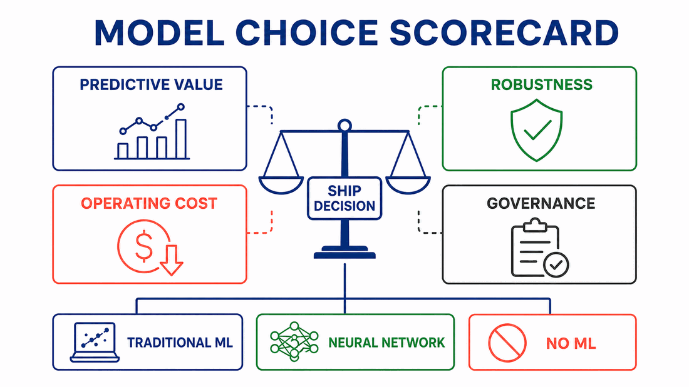

# Make the Product Decision

A model comparison ends with a product decision, not a leaderboard. The team
must connect technical evidence to users, business value, operating conditions,
and acceptable risk.

*Model-choice scorecard developed for this course.*

## Compare Credible Options

The final recommendation should consider at least:

1. **Current traditional ML model:** the existing reproducible baseline.
2. **Neural-network challenger:** the reasonable architecture evaluated in this
   project.
3. **No ML or simpler intervention:** a rule, process change, manual review, or
   decision not to automate.

An optional fourth candidate can be a stronger traditional model or hybrid
system when the evidence justifies it. Do not add candidates merely to make the
report look comprehensive.

## Use Decision Thresholds, Not Adjectives

Translate vague preferences into explicit criteria. Examples:

- minimum recall for a safety-critical class;
- maximum acceptable tail latency on target hardware;
- maximum review workload created by false positives;
- required explanation or audit trail;
- retraining frequency the team can support; and
- minimum practical improvement needed to justify migration.

A candidate that violates a hard constraint is not rescued by a high average
score. Among feasible candidates, describe the trade-offs and confidence in the
evidence.

## State the Recommendation and Its Limits

A useful decision memo answers:

- Which option should be shipped now?
- What evidence most strongly supports that choice?
- What evidence contradicts or weakens it?
- Which assumptions remain untested?
- What would need to change for the decision to flip?
- What monitoring or human oversight is required?

“Keep the traditional model” can be a strong outcome. The neural-network
implementation still created value by testing whether additional complexity was
worthwhile.

## Document the Chosen Model

The [Model Cards](https://research.google/pubs/model-cards-for-model-reporting/)
framework proposes
transparent reporting of intended use, evaluation, limitations, and relevant
groups. The report in this project is not a full production model card, but it
should preserve the same discipline: say where the evidence applies and where
it does not.

## Separate Evidence from Advocacy

Stakeholder communication should not hide inconvenient results. Use one clear
recommendation, then show the trade-off that matters most. Keep implementation
detail available in the comparison report and translate it into product impact
in the decision memo.

## Check Your Understanding

The neural network wins the primary metric but requires unavailable GPU
infrastructure to meet latency requirements. What should the memo recommend?

Show solution

The neural network is not currently feasible under the stated constraint. The
team may recommend the traditional model now and name the infrastructure,
compression, or latency evidence that would justify reconsidering the neural
network later.

## Further Reading

- [Model Cards for Model Reporting](https://research.google/pubs/model-cards-for-model-reporting/)
- [The ML Test Score](https://research.google/pubs/the-ml-test-score-a-rubric-for-ml-production-readiness-and-technical-debt-reduction/)
- [Green Algorithms](https://www.green-algorithms.org/)
