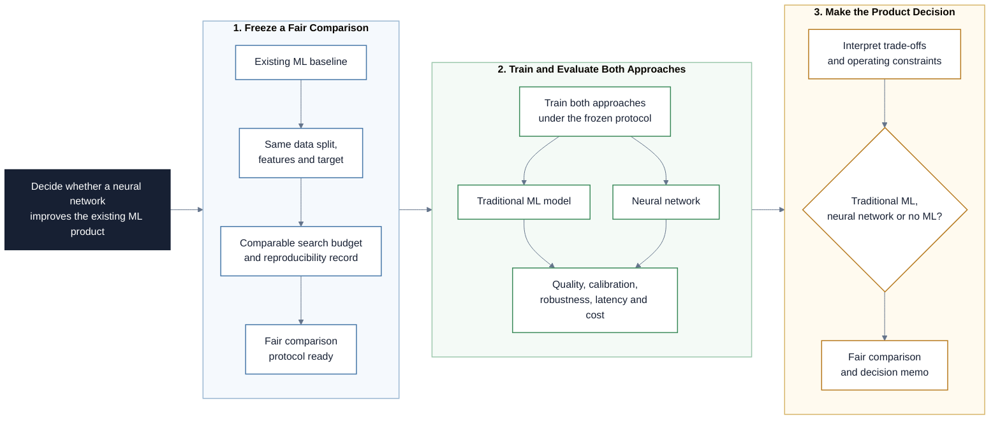

# Neural Networks for an Existing ML Project

This repository guides teams through extending an existing machine learning
project with a neural network and deciding whether the additional complexity is
justified. The objective is not to prove that one model family is universally
better. It is to design a fair comparison, evaluate product and operational
trade-offs, and defend a model choice with evidence.

## Project at a Glance

The project adds a neural network to an existing ML project without moving the
goalposts, then uses broad product evidence to decide whether it is worthwhile.

## Learning Objectives

By the end of this repository, you should be able to:

- Explain when neural networks are promising and when strong traditional ML
  baselines remain competitive.
- Design a fair comparison using the same observations, test set, decision
  metric, and documented tuning budget.
- Build a reasonable neural-network challenger without turning the project into
  an architecture competition.
- Account for training variability by repeating stochastic experiments and
  reporting dispersion.
- Evaluate calibration, error costs, robustness, latency, resource use,
  interpretability, and maintainability alongside predictive performance.
- Compare traditional ML, a neural network, and a no-ML alternative.
- Produce a traceable recommendation and state what evidence would change it.

## Learning Path

The modules build on each other in order.

| File / Folder | Description |
|---|---|
| [**01 - When Neural Networks Help**](01-when-neural-networks-help.md) | Understand what neural networks add, why data modality matters, and why no model family wins everywhere. |
| [**02 - Design a Fair Comparison**](02-design-a-fair-comparison.md) | Freeze a leakage-safe protocol, comparable search budget, and reproducibility record before training. |
| [**03 - Evaluate Beyond One Metric**](03-evaluate-beyond-one-metric.md) | Compare predictive quality, calibration, robustness, latency, cost, and operating constraints. |
| [**04 - Make the Product Decision**](04-make-the-product-decision.md) | Turn the evidence into a decision among traditional ML, a neural network, or no ML. |
| [**05 - Project Handout**](05-project-handout.md) | Extend your existing ML project and deliver a fair comparison plus a decision memo. |

### Additional Folders and Files

| File / Folder | Description |
|---|---|
| [**assets**](assets/) | Local, attributed diagrams and research figures used throughout the modules. |
| [**templates**](templates/) | Comparison-plan, evidence-report, and decision-memo structures to copy into the existing ML project. |

## Getting Started

This is a reference repository. Do not start a new ML project or replace your
existing repository.

1. Read the modules in order.
2. Open the repository containing your completed traditional ML project.
3. Copy the three files from `templates/` into that project repository.
4. Confirm that the original test split, model result, and evaluation metric can
   still be reproduced.
5. Follow the project handout and add the neural-network work to the same
   repository.

Use the environment and framework already selected for the preceding neural
networks course. TensorFlow/Keras is a convenient option, but PyTorch or another
appropriate framework is acceptable when the team documents the choice.

## References & Further Reading

- [Grinsztajn, Oyallon, and Varoquaux: Why do tree-based models still outperform deep learning on typical tabular data?](https://papers.nips.cc/paper_files/paper/2022/hash/0378c7692da36807bdec87ab043cdadc-Abstract-Datasets_and_Benchmarks.html)
- [Gorishniy et al.: Revisiting Deep Learning Models for Tabular Data](https://arxiv.org/abs/2106.11959)
- [scikit-learn: Model selection and evaluation](https://scikit-learn.org/stable/model_selection)
- [Keras: Reproducibility in Keras Models](https://keras.io/examples/keras_recipes/reproducibility_recipes/)
- [Guo et al.: On Calibration of Modern Neural Networks](https://proceedings.mlr.press/v70/guo17a.html)
- [Schwartz et al.: Green AI](https://arxiv.org/abs/1907.10597)
- [Mitchell et al.: Model Cards for Model Reporting](https://research.google/pubs/model-cards-for-model-reporting/)
